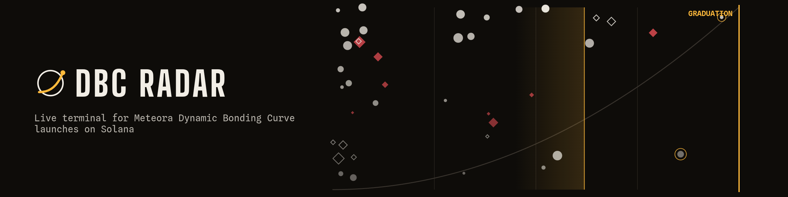
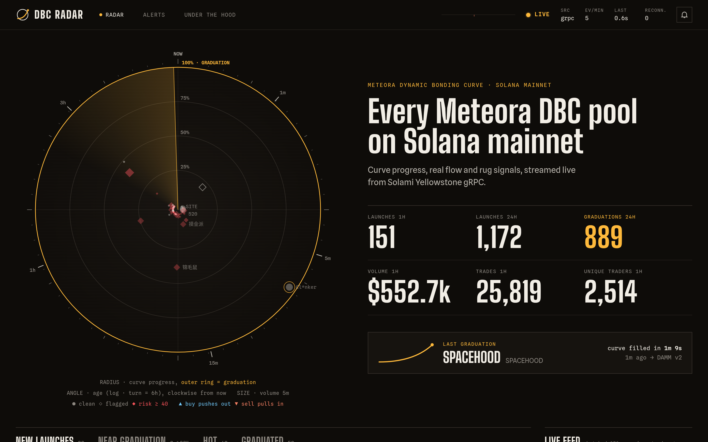
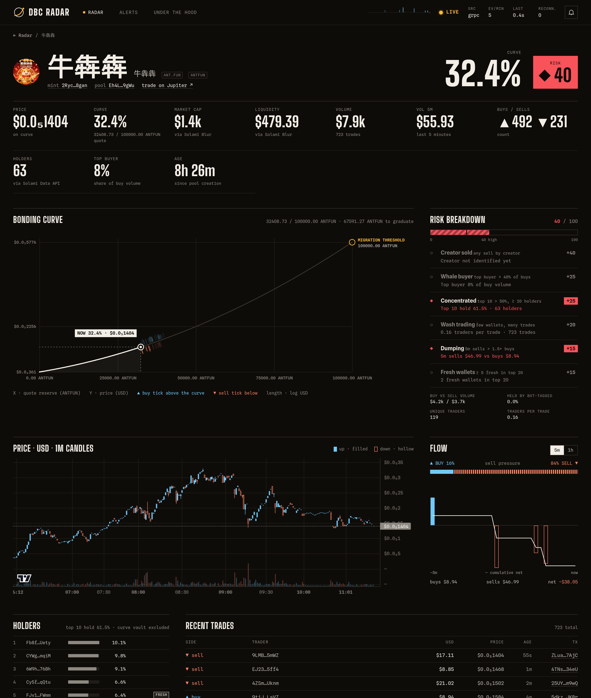
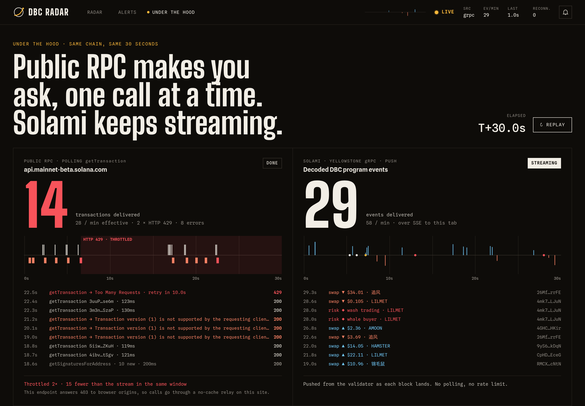
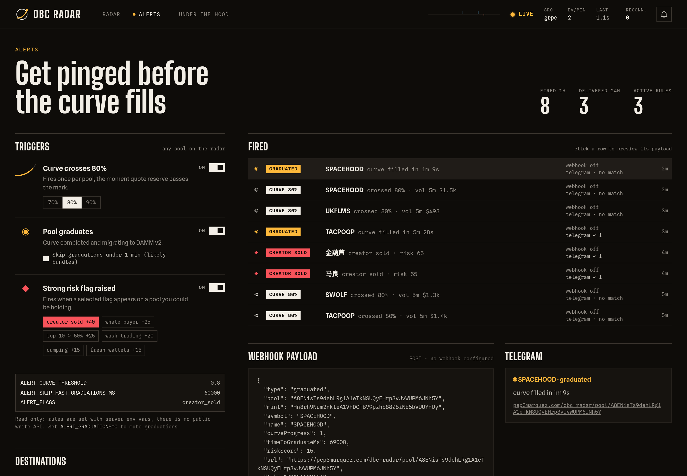
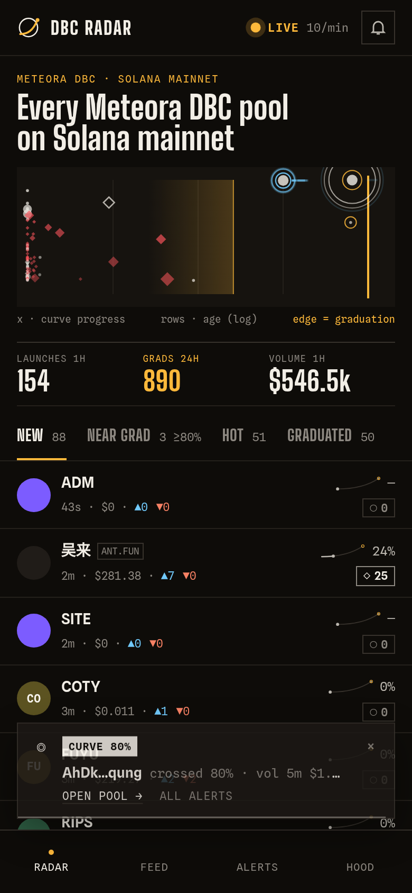
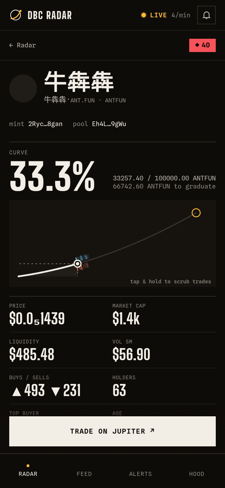
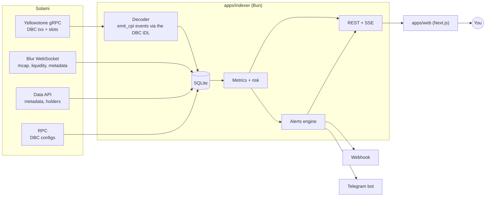

<p align="center">
  
</p>

<p align="center">
  <b>A live radar for every Meteora Dynamic Bonding Curve launch on Solana mainnet.</b><br>
  Curve progress, real buy/sell flow, holders and rug signals, streamed in real time with <a href="https://solami.dev">Solami</a>.
</p>

<p align="center">
  <a href="https://pep3marquez.com/dbc-radar"><b>Live app</b></a> ·
  <a href="https://pep3marquez.com/dbc-radar/about">Under the hood</a> ·
  <a href="https://t.me/dbcradar_bot">Telegram alerts</a> ·
  <a href="#run-it-locally">Run it locally</a> ·
  <a href="#api">API</a>
</p>

---

Hundreds of tokens launch on Meteora's Dynamic Bonding Curve every hour. Most of them never graduate, many of them are rugs, and a few fill their curve in under a minute. DBC Radar watches all of them as it happens and answers, for each launch:

- **How close is it to graduating?** Progress is computed from the swap events themselves (quote reserve vs migration threshold), and the pool page draws the real bonding curve from the pool's on-chain config with every trade plotted on it.
- **Is the flow real?** Buy and sell volume in USD, unique traders, 5-minute and 1-hour flow, 1-minute candles.
- **Who holds it?** Top holders with creator / bot / fresh-wallet tags, top-10 concentration excluding the curve vault.
- **Should I worry?** A 0–100 risk score from six on-chain heuristics: the creator sold, one whale bought most of the supply, wash trading, dumping, concentrated holders, fresh wallets.
- **Tell me when it matters.** Alerts when a pool crosses 80% of its curve, graduates, or raises a strong flag: in-app toasts, browser notifications, a signed webhook and a Telegram bot where every subscriber picks their own threshold and flags.

## Screenshots

| Radar | Pool detail |
|---|---|
|  |  |
| **Under the hood** | **Alerts** |
|  |  |

<p align="center">
  
  &nbsp;
  
</p>

**Radar.** Every pool of the selected list is a blip on the scope: the radius is curve progress (the outer amber ring is graduation), the angle is age on a log scale, the size is 5-minute volume and the shape is risk. Buys push a blip out, sells pull it in, launches ping, graduations burst. The sweep speed follows the live event rate. Below it: new launches, near graduation, hot and graduated lists, and a live feed of every swap.

**Under the hood.** A real race that runs in your browser for 30 seconds: on the left, a naive client polling the public Solana RPC (`getSignaturesForAddress` + `getTransaction`, one call at a time) until it gets rate limited with HTTP 429; on the right, the decoded events Solami's Yellowstone gRPC pushes to this tab over the same window. Below it, the live data path with throughput per source and the gRPC vs Blur latency for every signature.

## How Solami is used

Solami does the real work here: every number on the site comes from one of its products.

| Solami product | What DBC Radar uses it for |
|---|---|
| **Yellowstone gRPC** (`grpc.solami.dev`) | The source of truth. One subscription filtered server-side to the DBC program (`dbcij3LWUppWqq96dh6gJWwBifmcGfLSB5D4DuSMaqN`) at `processed` commitment delivers every transaction with its inner instructions, so the indexer decodes the program's `emit_cpi` events (pool created, swaps, curve complete) without a single follow-up RPC call. A slot subscription on the same stream gives the latency reference. Reconnects resume from the last slot seen (`fromSlot`), so gaps are replayed, not lost. |
| **Blur WebSocket** (`ws.solami.dev`) | Live market data for DBC pools: market cap, liquidity, token metadata and graduation messages. Also used as a second, independent stream to measure gRPC vs Blur latency per signature. |
| **Data API** (`api.solami.dev`) | Token metadata in batches (name, symbol, logo, socials) and holders with tags (`bot`, `fresh`, …) for the holders panel, concentration and fresh-wallet risk flags. |
| **RPC** (`rpc.solami.dev`) | Each DBC config account is read once (batched `getMultipleAccounts`) and cached in SQLite, to rebuild each pool's real bonding curve (price as a function of quote reserve). |

Measured in production (`/api/pipeline`): gRPC delivers a DBC transaction ~110 ms after its slot first appears on the wire (p50), Blur ~380 ms, and gRPC arrives first for ~99% of signatures. Without a key the indexer falls back to the public RPC (`logsSubscribe` + `getTransaction`), which drops events as soon as it is rate limited; that gap is exactly what the Under the hood page shows.

## Architecture



- **`apps/indexer`** (Bun, TypeScript): sources (`sources/yellowstone.ts`, `sources/blur.ts`, `sources/rpc.ts` fallback), the DBC event decoder (`decoder/dbc.ts`, using the IDL from `@meteora-ag/dynamic-bonding-curve-sdk`), ingestion into SQLite (`bun:sqlite`), enrichment, USD prices for quote mints, metrics and risk (`metrics.ts`), the real curve (`dbc-configs.ts`), alerts (`alerts.ts`, `telegram.ts`), telemetry (`telemetry.ts`) and the HTTP API (`api/server.ts`). The types shared with the web live in `src/domain/api.ts`.
- **`apps/web`** (Next.js 16, React 19, Tailwind CSS v4): the radar scope is a single `<canvas>` drawn every frame from a mutable model; one shared Server-Sent Events connection feeds the scope, the feed, the pool page and the alert toasts; DOM updates are batched at 4 Hz. Candles use TradingView `lightweight-charts`.
- **`edge/`**: a Cloudflare Worker that serves the app under `pep3marquez.com/dbc-radar`.

## Run it locally

Requirements: [Bun](https://bun.sh) 1.2+ and a Solami API key (get one at [solami.dev](https://solami.dev)). Without a key it still runs, on the lossy public RPC fallback.

```bash
git clone https://github.com/Pep3M/dbc-radar.git
cd dbc-radar
bun run setup   # installs deps, creates apps/indexer/.env, asks for your Solami key and checks it
bun dev         # indexer on :4000 + web on :3100
```

Open **http://localhost:3100/dbc-radar**. The indexer needs a few seconds to open the gRPC stream before the API answers, and the first pools appear as soon as the next DBC transaction lands (usually within seconds).

**Using your key.** `bun run setup` writes it to `apps/indexer/.env` as `SOLAMI_API_KEY=…`; you can also edit that file by hand (start from `apps/indexer/.env.example`). The same key authenticates gRPC (`x-token`), Blur, the Data API and the RPC. It never reaches the browser: the web app only talks to the indexer.

Run the apps separately if you prefer:

```bash
cd apps/indexer && bun --watch src/index.ts           # API on :4000
cd apps/web && bun --bun next dev -p 3100            # INDEXER_URL defaults to http://localhost:4000
```

Checks: `bunx biome ci .` · `bunx tsc --noEmit -p apps/indexer` · in `apps/web`: `bunx next typegen && bunx tsc --noEmit -p .`

### Environment variables

**Indexer** (`apps/indexer/.env`; all optional except the key for the full experience):

| Variable | Default | What it does |
|---|---|---|
| `SOLAMI_API_KEY` | | Enables gRPC, Blur, the Data API and the RPC. Empty → public RPC fallback. |
| `SOURCE` | `grpc` with a key, else `rpc` | Transaction source. |
| `GRPC_COMMITMENT` | `processed` | `processed` (fastest) or `confirmed` (waits for votes, ~0.5–1 s later). |
| `SOLAMI_GRPC_URL` | `https://grpc.solami.dev` | Yellowstone gRPC endpoint. |
| `SOLAMI_BLUR_WS_URL` | `wss://ws.solami.dev/data/subscribe` | Blur WebSocket. |
| `SOLAMI_DATA_API_URL` | `https://api.solami.dev` | Data API. |
| `SOLAMI_RPC_URL` | `https://rpc.solami.dev/solana` | RPC used to read DBC configs. |
| `RPC_URL` / `RPC_WS_URL` / `RPC_MAX_CONCURRENCY` | public mainnet / derived / `4` | Fallback source when there is no key. |
| `PORT` | `4000` | Indexer HTTP port. |
| `DB_PATH` | `../../data/radar.sqlite` | SQLite file (relative to `apps/indexer`). |
| `PUBLIC_URL` | `https://pep3marquez.com/dbc-radar` | Base URL used in alert links. |
| `ALERT_CURVE_THRESHOLD` | `0.8` | Site-wide curve alert level (`0` disables). |
| `ALERT_GRADUATIONS` | `1` | Graduation alerts on/off. |
| `ALERT_SKIP_FAST_GRADUATIONS_MS` | `60000` | Skip graduations faster than this (usually bundles). |
| `ALERT_FLAGS` | `creator_sold` | Risk flags that fire alerts (comma list, `none` disables). |
| `ALERT_WEBHOOK_URL` / `ALERT_WEBHOOK_SECRET` | | POST every alert as JSON, signed with `X-DBC-Signature: sha256=<HMAC>` when a secret is set. |
| `TELEGRAM_BOT_TOKEN` | | Runs the subscriber bot (token from @BotFather). |
| `TELEGRAM_POLLING` | `1` | Only one process may poll a bot: set `0` on every other instance (e.g. local dev while production runs it). |
| `TELEGRAM_CHAT_ID` | | Optional fixed chat or channel that receives every site-wide alert. |

**Web** (`apps/web`): `INDEXER_URL` (default `http://localhost:4000`) and `BASE_PATH` (default `/dbc-radar`).

## API

The indexer exposes everything the UI uses, so the radar doubles as a data stream for terminals and bots. In production it is reachable at `https://pep3marquez.com/dbc-radar/api/…`; locally at `http://localhost:4000/api/…`.

| Endpoint | Returns |
|---|---|
| `GET /api/pools?sort=new\|hot\|progress&limit=50` | Pool summaries: progress, price, mcap, volume, buys/sells, holders, top-10, launchpad, risk score and flags. |
| `GET /api/pools/:pool` | Everything above plus recent trades, 1m candles, real curve samples, top holders, 5m/1h flow, DAMM v2 pool after graduation. |
| `GET /api/graduated?limit=20` | Recently graduated pools with time to graduate. |
| `GET /api/stats` | Launches, graduations, volume, trades and traders (1h / 24h). |
| `GET /api/stream` | Server-Sent Events: `pool_created`, `trade`, `graduated`, `risk`, `alert`. |
| `GET /api/pipeline` | Live throughput and latency per source, gRPC vs Blur per signature. |
| `GET /api/alerts` | Alert rules, destinations (no secrets) and the last 50 alerts with their exact payloads. |
| `GET /api/health` | Source status, reconnects, last event age. |

```bash
curl -N https://pep3marquez.com/dbc-radar/api/stream
# data: {"type":"trade","pool":"…","symbol":"…","side":"buy","usdAmount":24.8,"progress":0.76,…}
```

Types for every response are in [`apps/indexer/src/domain/api.ts`](apps/indexer/src/domain/api.ts).

## Telegram alerts

Open [@dbcradar_bot](https://t.me/dbcradar_bot) and send `/start`. Defaults: curve crossing 80%, graduations (skipping sub-minute bundles) and `creator_sold`. Change them with the inline buttons or with `/threshold 50|70|80|90`, `/flags`, `/grads on|off`; `/status` shows your settings and `/stop` unsubscribes.

## Risk score

| Flag | Weight | Rule |
|---|---|---|
| `creator_sold` | 40 | The pool creator sold any amount. |
| `whale_buyer` | 25 | One wallet made more than 40% of the buy volume. |
| `concentrated` | 25 | Top 10 holders own more than 50% (with at least 20 holders, curve and DAMM vaults excluded). |
| `wash_trading` | 20 | At least 20 trades and fewer than 0.15 unique traders per trade. |
| `dumping` | 15 | 5-minute sells above 1.5× buys. |
| `fresh_wallets` | 15 | At least 5 wallets tagged `fresh` by the Solami Data API in the top 20 holders. |

The score is capped at 100. These are heuristics over on-chain flow, not financial advice.

## Deployment

GitHub Actions lints and type-checks, builds two images (`ghcr.io/pep3m/dbc-radar/indexer` and `/web`, based on `oven/bun:1-alpine`) and triggers a redeploy of [`docker-compose.prod.yml`](docker-compose.prod.yml) on Dokploy. Only the web container is exposed; it proxies `/dbc-radar/api/*` to the indexer, whose SQLite database lives in a volume. A Cloudflare Worker in [`edge/`](edge) serves it under `pep3marquez.com/dbc-radar`.

---

Built for the Colosseum Crypto World's Fair by [pep3marquez](https://pep3marquez.com). Data by [Solami](https://solami.dev).
